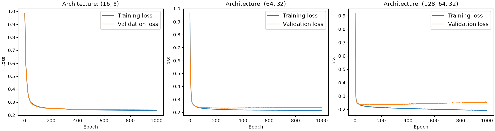
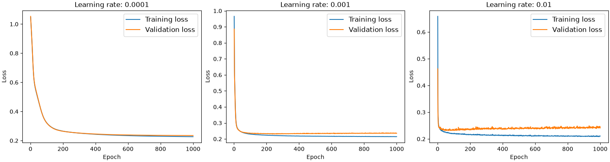
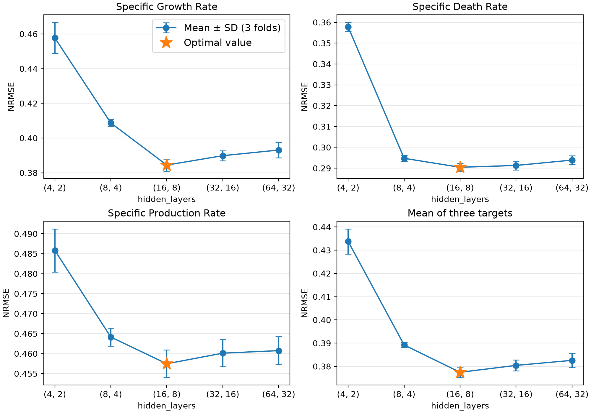
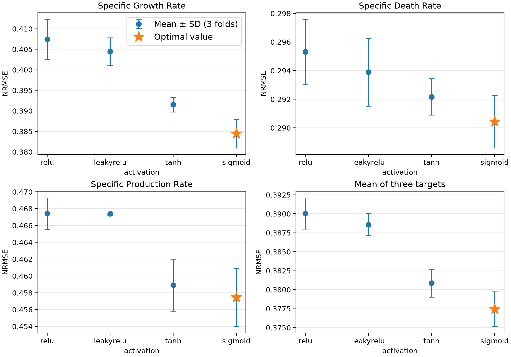
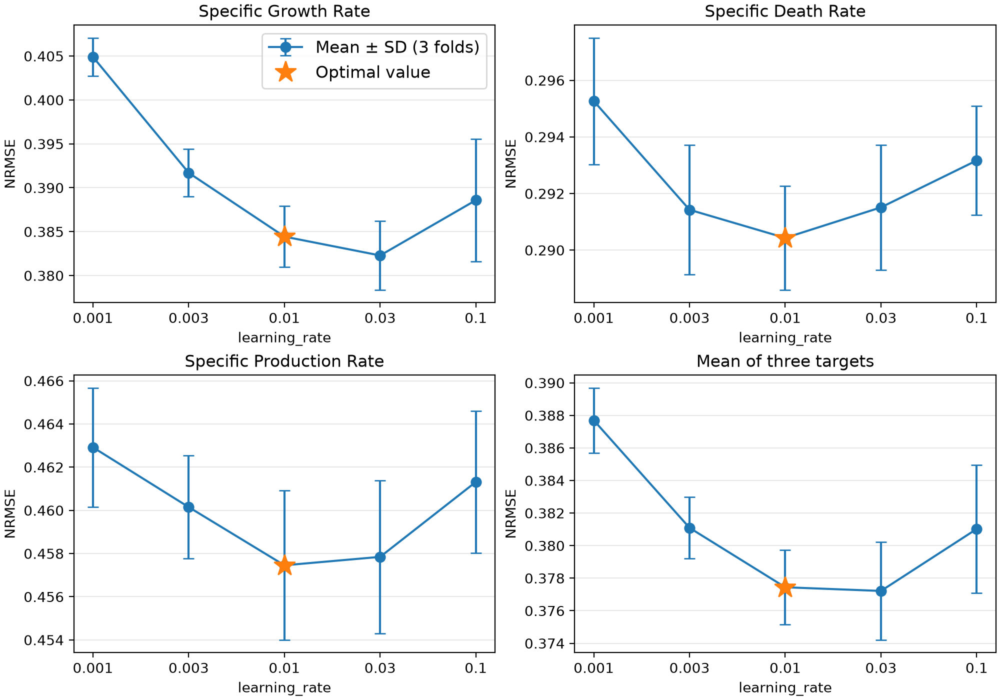
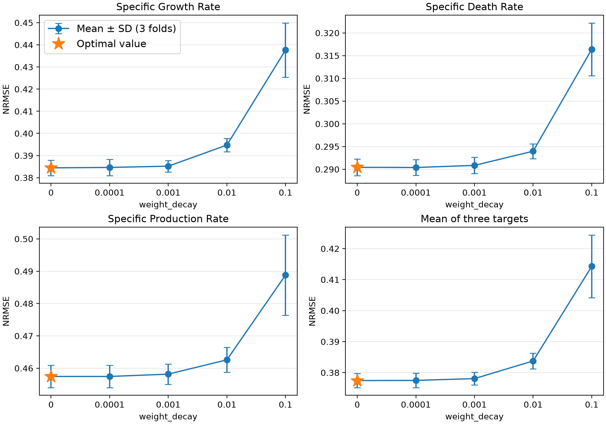
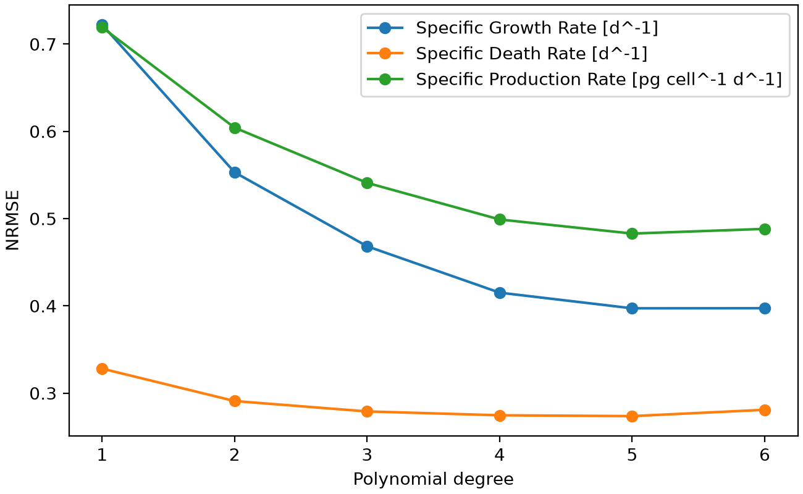

# Cell Culture Growth Modeling and Neural Network Optimization
This project develops and evaluates various machine learning models to predict cell culture behavior based on experimental 
process data. A fully connected deep neural network (DNN) is implemented using PyTorch to predict three targets:
specific growth rate, specific death rate and specific production rate. A systematic grid search is used to evaluate different 
hyperparameter combinations and identify the best-performing configuration, followed by cross-validation to assess the 
selected model's performance. The project also investigates the effects of five hyperparameters (hidden layers architecture, 
activation function, learning rate, batch size and weight decay) on model performance, and compares its predictive accuracy 
with polynomial regression. By combining predictive modeling, hyperparameter optimization and model evaluation, the project 
explores the application of machine learning to bioprocess modeling and optimization.

## Highlights
* Developed a fully connected deep neural network using PyTorch to predict three cell culture response variables from
experimental data.
* Designed pilot experiments to investigate the effects of neural network architecture and learning rate on training
convergence and computational efficiency.
* Implemented a systematic hyperparameter grid search with checkpointing and workload distribution among the group to improve computational efficiency and reproducibility.
* Evaluated model performance using RMSE, NRMSE and cross-validation to compare predictive accuracy across multiple target variables.
* Compared deep neural network predictions to polynomial regression predictions to assess different modeling approaches.

## Environment

* Python: 3.14.7
* matplotlib: 3.11.0
* numpy: 2.5.2
* pandas: 3.0.5
* scikit-learn: 1.9.0
* torch: 2.13.0

## Code Design

### Pilot Experiments
The `pilot.py` script was developed to investigate the influence of neural network architecture and learning rate on training 
convergence and computational efficiency before conducting the full hyperparameter search, as both can have a large impact.
These preliminary results were also used to assess whether a maximum training budget of 1,000 epochs would be suitable.

Two sets of experiments were performed on the complete dataset. First, three hidden-layer architectures, (16,8), (64,32)
and (128,64,32) were evaluated while keeping the other hyperparameters constant. The activation function was set to ReLu,
the learning rate to 0.001, the batch size to 1024 and the weight decay was omitted (0). The same methodology was used to
test learning rates of 0.0001, 0.001 and 0.01 with the hidden-layer architecture set to (64,32) and all the other hyperparameters
unchanged.

Each experiment trained a fully connected neural network for a maximum of 1,000 epochs. The training and validation loss
histories were recorded, along with the best validation epoch, the final training and validation losses, and the execution
time. These were saved in CSV tables and the corresponding loss curves were generated using plotting functions located in
`src/functions.py`.

These experiments allowed for an initial assessment of convergence and computational cost, which informed the selection
of the epoch budget and of the hyperparameter ranges for the grid search.

### Hyperparameter Search
The hyperparameter search was implemented using `grid_search.py` and the reusable functions in `src/functions.py`. A grid
search was performed to systematically evaluate combinations of five hyperparameters: hidden-layer architecture, activation
function, learning rate, batch size and weight decay. The search space consisted of three architectures, four activation
functions, three learning rates, three batch sizes and three weight decay values. This resulted in 324 unique configurations.

Each configuration was evaluated using the fully connected neural network model with a maximum training budget of 1,000
epochs. The `run_search()` function trained and evaluated each configuration, recording the RMSE and NRMSE for all three
targets, as well as the best validation epoch and training time.

To distribute the computational workload, the search space was divided equally into three unique subsets, using the `split_grid()`
function. Each group member evaluated 108 configurations independently. The results from each subset were saved into CSV 
tables progressively using checkpointing, to allow completed evaluations to be retained if execution was interrupted.

Once all three subsets were completed. `grid_search_analysis.py` was used to combine the results into a single dataset.
The `combine_tables()` function merged the individual result files, while `rank_hyperparameters()` calculated the mean
NRMSE across the three targets for each configuration to rank them in ascending order. The configuration with the lowest
mean NMRSE was selected for subsequent cross-validation and sensitivity analysis.

### Sensitivity Analysis
The sensitivity analysis was implemented using `sensitivity_analysis.py` and the reusable functions in `src/functions.py`.
A one factor at a time approach was used to evaluate the influence of five hyperparameters: hidden-layer architecture,
activation function, learning rate, batch size and weight decay. Each hyperparameter was varied independently while the
remaining parameters were fixed at the optimal configuration identified by the grid search.

Five hidden-layer architectures, four activation functions, five learning rates, five batch sizes and five weight decay
values were evaluated. Each configuration was assessed using 3-fold cross-validation, and the mean NRMSE across the three
target variables was used to compare their predictive performances,

To avoid redundant evaluations, repeated configurations were identified and only evaluated once. The results were saved 
to CSV files and summarized using `summarize_sensitivity()` and `summarize_overview()`, which calculated performance differences
relative to the optimal configuration and identified the best and worst values for each hyperparameter. The `plot_sensitivity()`
function generated figures illustrating the influence of each hyperparameter on prediction error.

### Polynomial Regression Comparison
This script builds a polynomial regression model and compares it with the optimal neural network. It answers one question:
is the network worth its extra training time?

**Data and split.** The script loads the 7-factor dataset and separates the 7 process features (x) from the 3 targets (y).
It keeps 20% of the data as a test set, using TEST_SIZE and RANDOM_SEED from src/constants.py. This is needed so the model is evaluated on data it never saw,
with the same split as the rest of the project.

**Degree search.** For each degree from 1 to 6, the script builds a pipeline: StandardScaler, the PolynomialFeatures (without a bias column),
then LinearRegression. The scaler puts all features on the same scale. PolynomialFeatures adds squared and cross terms,
so a linear model can fit non-linear effects.
The model is trained on the training set and tested on the test set. For each target, the script computes the RMSE and the NRMSE 
(RMSE divided by the IQR of the target), so targets with different units can be compared.

**Best degree.** The script averages the NRMSE of the 3 targets for each degree and keeps the lowest one. The choice is made on test error, not training error,
because training error always drops when the degree goes up. The figure figures/figure_polynomial_degree.png shows NRMSE against degree for each target.

**Cross-validation.** One train/test split can be lucky or unlucky. So the script runs a 4-fold cross-validation of the best degree, one target at a time.
It saves the mean and standard deviation of RMSE and NRMSE, and the mean fit time, in tables/table_polynomial_cv.csv. We used 4 folds, like the cross-validation of the 
optimal network, so both models are evaluated the same way.

**Comparison.** The script reads then polynomial results and the network results (tables/table_cv_optimal_summary.csv) and puts the NRMSE of both models side by side for each target in tables/table_comparison_poly_vs_nn.csv.
It also prints the mean fit time of each model. These numbers are used in the Comparison with Polynomial Regression section.

## Analysis
### Pilot experiments findings
As previously mentioned, the pilot experiments were conducted to determine the influence of neural network architecture 
and learning rate on convergence, validation loss and computational efficiency. They also helped determine a suitable
training budget for the upcoming hyperparameter search.

#### Influence of network architecture
Three different neural network architectures were evaluated using the ReLU activation function and a learning rate of 0.001.
The (64,32) architecture achieved the lowest best validation loss, 0.231565, compared with 0.238272 for (16,8) and 0.231991
for (128,64,32). While the largest architecture achieved a slightly lower final training loss (0.192251), its final validation
loss was higher (0.255762), suggesting overfitting under the tested conditions. The (16,8) and (64,32) architectures required 
approximately 34-35 seconds to train while the (128,64,32) architecture took 39 seconds. 

Therefore, increasing network complexity did not consistently improve validation performance, and instead, it led to 
additional computational costs.

#### Influence of learning rate
Learning rates of 0.0001, 0.001 and 0.02 were evaluated using the (64,32) architecture. It was noted that increasing the
learning rate accelerated convergence, with the best validation epoch decreasing from 994 at 0.0001 to 267 at 0.001 and
68 at 0.01.

The lowest best validation score was obtained with a learning rate of 0.01 (0.231277), although its final validation loss
(0.241241) was higher than the final validation loss obtained with 0.0001 (0.234927). This indicates that faster convergence
did not necessarily lead to better performances at the final epoch, and it highlights the importance of retaining the model
parameters corresponding to the lowest validation loss.

#### Training budget selection
A maximum of 1,000 epochs was decided for the full hyperparameter search, to balance both training time and convergence.
The pilot experiments demonstrated that the epoch at which validation loss was minimal varied significantly across the
various hyperparameter combinations. This made it clear that a sufficiently large training budget was necessary.

A subsequent 4-fold cross-validation check compared 1,0000 and 2,000 epochs using the optimal network configuration. It 
was found that doubling the number of epochs only improved mean NRMSE by about 0.36% for the specific growth rate, 0.08%
for the specific death rate and 0.01% for the production rate. These marginal differences supported keeping 1,0000 epochs
as the training budget as a compromise between predictive performance and computational efficiency.

Overall, the pilot experiments demonstrated that larger networks and higher learning rates do not necessarily offer a better
generalization. Although the (64,32) architecture had the best performance in the pilot experiments, the subsequent full
grid search identified (16,8) as the optimum, for a specific hyperparameter configuration. This is why evaluating hyperparameters
together is primordial, and should be prioritized over selecting them solely based on preliminary experiments.

### Optimal hyperparameter configuration
The grid search evaluated 324 unique configurations to identify the fully connected neural network with the lowest prediction
error across the three target variables. Each combination was evaluated using the same maximum training budget of 1,000 
epochs, and their performance was ranked according to the NMRSE across each target.

The optimal configuration identified by the grid searched consisted of two hidden layers with 16 and 8 neurons, the sigmoid
activation function, a learning rate of 0.01, a batch size of 512 and no weight decay. This configuration achieved a NRMSE
of 0.369489. Since NRMSE accounts for differences in target scales, averaging the three target errors provided a common
criterion for selecting a combination that performed well across all three outputs.

As it was briefly mentioned above, the selected (16,8) architecture differed from the (64,32) architecture which had achieved
the lowest validation loss in the pilot experiments. However, the pilot experiments kept the other hyperparameters fixed
while the grid search evaluated all five hyperparameters jointly. Additionally, the pilot compared validation losses whereas
the grid search ranked the configurations based on their test-set NRMSE.

The optimal nerual network was relatively small compared with the other architectures considered, which suggests that 
additional neurons did not improve the model within the selected search space. Similarly, the selection of no weight decay
indicates that explicit weight regularization did not improve the ranking for this particular combination of hyperparameters.

Overall, the grid search demonstrated the importance of evaluating hyperparameters together. The optimal configuration was
subsequently subjected to 4-fold cross-validation to evaluate its predictive performance across different data partitions, 
and it was used as the reference configuration for the sensitivity analysis.

### Cross-Validation of the Optimal Network

### Sensitivity Analysis
**Hidden-layers, activation function, learning rate, batch size and weight decay.** Each of these hyperparameters was changed one at a time around the optimal network ((16,8),sigmoid, learning rate 0.01, batch size 512, weight decay 0),
with 3-fold cross-validation. The values below are the mean NRMSE of the 3 targets.

**Hidden-layer architecture.** The optimal architecture (16,8) gives a mean NRMSE of 0.377. Smaller architectures perform
worse: (8,4) gives 0.389 (+3.1%) and (4,2) gives 0.434 (+14.9%). With too few neurons, the network does not have enough
capacity to capture the relationships between the inputs and outputs, which leads to underfitting.
Larger architectures also performed slightly worse: (32,16) gives 0.380 (+0.8%) and (64,32) gives 0.383 (+1.4%). These
larger networks reach their best validation epochs much earlier (471 and 101 respectively, compared with 951 for (16,8)),
but they do not achieve better prediction accuracy. They also take longer to train (43-44 seconds compared to 39 seconds).
The (16,8) architecture therefore provides the best balance between predictive accuracy and computational efficiency, among
the architectures that were tested. Hidden-layer size has the strongest effect of the five hyperparameters, with a maximum
NMRSE increase of 14.9%.

**Activation function.** Sigmoid gives the lowest mean NRMSE of 0.377. Tanh performs slightly worse, with an NRMSE of 0.381
(+0.9%), followed by Leaky ReLU at 0.389 (+3.0%) and ReLU at 0.390 (+3.3%). Sigmoid and tanh are smooth, nonlinear activation
functions, which might be helping the network capture the relationships between the input and output variables under the
tested conditions. ReLU and Leaky ReLU reach their best validation epochs earlier (881 and 710 respectively, compared to
951 for sigmoid), but they do not achieve better prediction accuracy. Training times remain similar across all four activation
functions (about 39-40 seconds), suggesting that the activation function has a greater effect on predictive performance 
than on computational cost for this experiment.

**Learning rate.** The optimal value 0.01 gives a NRMSE of 0.377. A smaller learning rate is worse: 0.001 gives 0.388 (+2.7%). With small steps, the network learns too slowly,
and its best epoch is almost the last one (990 out of 1000), so it was still learning when training stopped. A larger learning rate is also worse: 0.1 gives 0.381 (+1.0%).
The network reaches its best epoch much earlier (372), but at a higher error, because the steps are too large and jump over the minimum. The value 0.03 gives the same error as 0.01 (-0.04%, smaller than the fold-to-fold variation)
and reaches its best epoch earlier (613).

**Batch size.** Batch size has the weakest effect of all hyperparameters: at most +1.0%. The largest batch size, 2048, is the worst (0.381), because it makes 4 times fewer weight updates per epoch than 512,
so the network learns less in 1000 epochs. The smallest batch size, 128, is not more accurate (0.378) and is the slowest to train (59 s against 39 s for 512).
Batch size 512 is the best trade-off between accuracy and training time.

**Weight decay.** No value of weight decay improves the network: 0.0001 and 0.001 give almost the same error as 0 (0.378).
This means the network does not overfit, so regularization is not needed. Larger values make it worse: 0.01 gives 0.384 (+1.7%) and 0.1 gives 0.414 (+9.9%).
With too much weight decay, the weights are pushed too close to zero and the model becomes too simple (underfitting).

### Comparison with Polynomial Regression
The polynomial model was chosen by testing degrees 1 to 6 on the test set. The mean NRMSE dropped from 0.590 at degree 1 to 0.385 at degree 5,
then rose to 0.389 at degree 6, which shows overfitting. Degree 5 was kept and evaluated with 4-fold cross-validation, like the optimal network.

| target                                     | poly_NRMSE_mean | poly_NRMSE_std | nn_NRMSE_mean | nn_NRMSE_std |
|--------------------------------------------|-----------------|----------------|---------------|--------------|
| Specific Growth Rate [d^-1]                | 0.402           | 0.004          | 0.385         | 0.006        |
| Specific Death Rate [d^-1]                 | 0.298           | 0.001          | 0.285         | 0.025        |
| Specific Production Rate [pg cell^-1 d^-1] | 0.481           | 0.005          | 0.457         | 0.002        |

The neural network is more accurate for all 3 targets, by 4.2 to 5.0%. For the death rate, the difference (0.013) is smaller than the variation of the network between folds (0.025),
so the improvement is not clear for this target. The network is also much slower: one fit takes about 40 seconds against about half a second for the polynomial, roughly 80 times longer.
The network is the most accurate model, but the polynomial is a strong and fast baseline.
One small difference between the two evaluations: the polynomial cross-validation did not shuffle the data before splitting, while the network's did. We checked that shuffling changes the polynomial NRMSE by only about 0.001.

### Next Steps

**Finer search around the optimum.** The optimal network was at the edge of the grid search: 0.01 was the largest learning rate tested and (16, 8) was the smallest architecture.
The sensitivity analysis shows that a learning rate of 0.03 gives the same error as 0.01. A next step would be a finer search of the learning rate between 0.01 and 0.03.

**Architecture.** The number of neurons had the largest effect on the error (up to +15 %).
Smaller networks ((8, 4) and (4, 2)) and larger ones ((32, 16) and (64, 32)) were all worse than (16, 8).
Widths between (8, 4) and (32, 16), and other numbers of hidden layers, could be tested.

**Training time.** With a learning rate of 0.03, the best epoch is around 613 instead of 951.
Training with fewer epochs could reduce the training time without losing accuracy.

**Weight decay.** Weight decay did not improve the network, so it can stay at 0 and does not need to be searched again.

**Model choice.** The network is only 4.6 % more accurate than a degree-5 polynomial, but roughly 80 times slower to train.
If training time matters, the polynomial model is a reasonable alternative.
