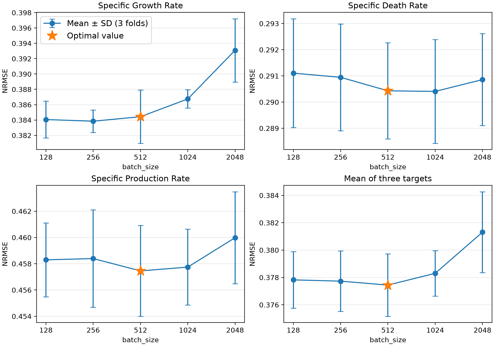

# Cell Culture Growth Modeling and Neural Network Optimization
This project develops and evaluates various machine learning models to predict cell culture behavior based on experimental 
process data. A fully connected deep neural network (DNN) is implemented using PyTorch to predict three targets:
specific growth rate, specific death rate and specific production rate. A systematic grid search is used to evaluate different 
hyperparameter combinations and identify the best-performing configuration, followed by cross-validation to assess the 
selected model's performance. The project also investigates the effects of five hyperparameters (hidden layers architecture, 
activation function, learning rate, batch size and weight decay) on model performance, and compares its predictive accuracy 
with polynomial regression. By combining predictive modeling, hyperparameter optimization and model evaluation, the project 
explores the application of machine learning to bioprocess modeling and optimization.

## Highlights
* Developed a fully connected deep neural network using PyTorch to predict three cell culture response variables from
experimental data.
* Designed pilot experiments to investigate the effects of neural network architecture and learning rate on training
convergence and computational efficiency.
* Implemented a systematic hyperparameter grid search with checkpointing and workload distribution among the group to improve computational efficiency and reproducibility.
* Evaluated model performance using RMSE, NRMSE and cross-validation to compare predictive accuracy across multiple target variables.
* Compared deep neural network predictions to polynomial regression predictions to assess different modeling approaches.

## Environment

* Python: 3.14.7
* matplotlib: 3.11.0
* numpy: 2.5.2
* pandas: 3.0.5
* scikit-learn: 1.9.0
* torch: 2.13.0

## Code Design

(to be written: 500-1500 words, organized into Heading 3 subsections)

### Polynomial Regression Comparison
This script builds a polynomial regression model and compares it with the optimal neural network. It answers one question:
is the network worth its extra training time?

**Data and split.** The script loads the 7-factor dataset and separates the 7 process features (x) from the 3 targets (y).
It keeps 20% of the data as a test set, using TEST_SIZE and RANDOM_SEED from src/constants.py. This is needed so the model is evaluated on data it never saw,
with the same split as the rest of the project.

**Degree search.** For each degree from 1 to 6, the script builds a pipeline: StandardScaler, the PolynomialFeatures (without a bias column),
then LinearRegression. The scaler puts all features on the same scale. PolynomialFeatures adds squared and cross terms,
so a linear model can fit non-linear effects.
The model is trained on the training set and tested on the test set. For each target, the script computes the RMSE and the NRMSE 
(RMSE divided by the IQR of the target), so targets with different units can be compared. It also measures the training time with time.perf_counter.
All results are saved in tables/table_polynomial_search.csv.

**Best degree.** The script averages the NRMSE of the 3 targets for each degree and keeps the lowest one. The choice is made on test error, not training error,
because training error always drops when the degree goes up. The figure figures/figure_polynomial_degree.png shows NRMSE against degree for each target.

**Cross-validation.** One train/test split can be lucky or unlucky. So the script runs a 4-fold cross-validation of the best degree, one target at a time.
It saves the mean and standard deviation of RMSE and NRMSE, and the mean fit time, in tables/table_polynomial_cv.csv. We used 4 folds, like the cross-validation of the 
optimal network, so both models are evaluated the same way.

**Comparison.** The script reads then polynomial results and the network results (tables/table_cv_optimal_summary.csv) and puts the NRMSE of both models side by side for each target in tables/table_comparison_poly_vs_nn.csv.
It also prints the mean fit time of each model. These numbers are used in the Comparison with Polynomial Regression section.

## Analysis

(to be written: 1000-3000 words, organized into Heading 3 subsections)

### Hyperparameter Search

### Cross-Validation of the Optimal Network

### Sensitivity Analysis

Camille's part

**Learning rate, batch size and weight decay.** Each of these hyperparameters was changed one at a time around the optimal network ((16,8),sigmoid, learning rate 0.01, batch size 512, weight decay 0),
with 3-fold cross-validation. The values below are the mean NRMSE of the 3 targets.

**Learning rate.** The optimal value 0.01 gives a NRMSE of 0.377. A smaller learning rate is worse: 0.001 gives 0.388 (+2.7%). With small steps, the network learns too slowly,
and its best epoch is almost the last one (990 out of 1000), so it was still learning when training stopped. A larger learning rate is also worse: 0.1 gives 0.381 (+1.0%).
The network reaches its best epoch much earlier (372), but at a higher error, because the steps are too large and jump over the minimum. The value 0.03 gives the same error as 0.01 (-0.04%, smaller than the fold-to-fold variation)
 and reaches its best epoch earlier (613).

**Batch size.** Batch size has the weakest effect of all hyperparameters: at most +1.0%. The largest batch size, 2048, is the worst (0.381), because it makes 4 times fewer weight updates per epoch than 512,
so the network learns less in 1000 epochs. The smallest batch size, 128, is not more accurate (0.378) and is the slowest to train (59 s against 39 s for 512).
Batch size 512 is the best trade-off between accuracy and training time.

**Weight decay.** No value of weight decay improves the network: 0.0001 and 0.001 give almost the same error as 0 (0.378).
This means the network does not overfit, so regularization is not needed. Larger values make it worse: 0.01 gives 0.384 (+1.7%) and 0.1 gives 0.414 (+9.9%).
With too much weight decay, the weights are pushed too close to zero and the model becomes too simple (underfitting).

### Next Steps

### Comparison with Polynomial Regression
The polynomial model was chosen by testing degrees 1 to 6 on the test set. The mean 

